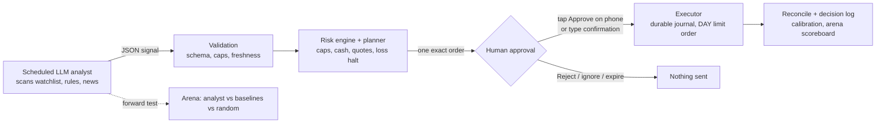

# AI Trader

[](https://github.com/taim-ss/ai-trader/actions/workflows/ci.yml)

**An LLM analyst scans the market for entry setups and pushes the opportunity to your phone. A plain-code risk engine
decides what is allowed to exist. Nothing reaches the broker until you tap Approve.**

The model never talks to the broker and cannot override a limit. It proposes target weights as a JSON signal; deterministic
code validates, sizes and gates every order; a human approves the exact order with one tap on a push notification; the
executor sends one limit order to the [Trading 212 API](https://docs.trading212.com/api), journals it, and reconciles it
on the next run. A forward-test arena scores the analyst against simple baselines on prices that did not exist when it
committed, so "does the AI add anything?" gets an honest answer instead of a backtest that the model has already seen.

> Educational, self-directed research tool. **Not financial advice.** No performance claim is made: see [Status](#status-and-honesty).

## How it works



1. **Scan.** An analyst run (any agent runtime on a schedule) researches the watchlist, applies the written entry rules and
   writes `data/ai_signals/<date>-<run>.json`. Unknown prices, unconfirmed earnings dates or conflicting sources mean *wait*.
2. **Validate.** `parse_signal` accepts only watchlist symbols, finite weights within the position cap, a written reason for
   every non-zero weight, at most five positions, and a fresh `as_of`. Invalid signals are rejected, never repaired.
3. **Gate.** The executor refreshes the account, reconciles earlier orders, and refuses on pending orders, insufficient cash
   (including a fee reserve), stale quotes, daily-loss halt, drawdown latch, loss cooldown, or a HALT file.
4. **Approve.** The exact order (side, size, ticker, limit price, approximate EUR) is pushed to your phone via
   [ntfy](https://ntfy.sh) with **Approve** and **Reject** buttons, or confirmed by a typed phrase in a terminal.
   The approval token is an HMAC bound to the order id, ticker, quantity, limit price and an expiry, so it cannot be reused for
   another order or after it expires. No tap means no order.
5. **Send.** The order that is sent must equal the order that was shown. The intent is written to a journal *before* the POST,
   there are no automatic retries, and an unknown outcome blocks later runs until a human reviews it.
6. **Learn.** Every decision is logged; explicit binary forecasts are scored (Brier); the arena compares the analyst with baselines.

## What is in the box

| Area | What it does | Where |
|---|---|---|
| Signal schema and validation | Strict JSON contract between the LLM and the code | `ai_signal.py`, `docs/analyst-prompt.md` |
| Risk engine | Per-name cap, per-order cap, daily-loss halt, drawdown latch, loss cooldown, no leverage/shorting/options | `risk.py`, `execution_state.py`, `config/risk_limits.yaml` |
| Executor | Durable order journal, reconciliation, freshness checks, idempotent cycles, HALT file, single DAY limit order per run | `demo_execution.py` |
| One-tap phone approval | Signed Approve/Reject buttons over ntfy; polling only, no inbound server | `phone_approval.py`, `scripts/setup_phone.py` |
| Typed approval | Exact order shown, confirmation phrase required, refuses without a real terminal | `approval.py` |
| Trading 212 clients | Demo and live clients that each refuse the other's URL; live market orders disabled | `paper_adapter.py` |
| Live gate | Live stays locked until the owner edits a git-ignored config and completes a checklist | `ai_signal.live_gate_blockers`, `config/live.example.yaml` |
| Forward-test arena | Pre-registered pass criteria, exposure-matched excess return, bootstrap interval, random-portfolio luck benchmark | `arena.py`, `scripts/arena.py` |
| Calibration | Brier scoring of explicit forecasts with verified outcomes | `calibration.py` |
| Baseline backtest | Deterministic 12-1 momentum ETF rule with costs, for context only | `backtest.py`, `reports/` |

Every safety property above has tests. The suite runs in CI with `mypy --strict`.

## Modes

- **demo** - Trading 212 practice account (virtual money). Plan, approve, send, reconcile; this path has been exercised end to end.
- **live** - real money, same path, but it refuses unless the owner has switched the gate on in `config/private_live.yaml`, and
  every order still needs approval. `live-auto` is deliberately impossible: the gate rejects any mode but `live-with-approval`.

## Quick start

```bash
python -m venv .venv && .venv/Scripts/activate   # Windows; use bin/activate on Linux/macOS
pip install -e ".[dev]"
pytest -q && mypy --strict src
```

Credentials come from environment variables only (names in `.env.example`; values never in files).

```bash
cp config/watchlist.example.yaml config/private_watchlist.yaml      # git-ignored
python scripts/paper_rebalance.py --signal examples/signal.example.json    # plan only: prints the order, sends nothing
python scripts/setup_phone.py --wait 240                                    # one-time: send a test tap to your phone
python scripts/paper_rebalance.py --signal FILE --phone --demo-only        # push the order to your phone, send it only on Approve
python scripts/arena.py board                                               # forward-test scoreboard (arena data lives outside the repo: ARENA_DIR, see config/arena.example.yaml)
```

Windows wrappers: `scripts/run_demo.ps1 -Signal FILE [-Phone|-Approve]`, `scripts/run_live.ps1 -Signal FILE [-Phone|-Approve]`.
An empty file named `HALT` in the repo root stops every run at the start and again right before the order.

## Scanning on a schedule

The analyst is a prompt-driven agent that runs *outside* this codebase, so you can use any agent runtime with a scheduler.
[`docs/scanner-prompt.md`](docs/scanner-prompt.md) is a generic scheduled-scan prompt: stop checks, entry rules, one proposal per
day, signal schema, and the exact command to hand the result to the approval flow. The code in `src/ai_trader` validates and
gates whatever the analyst writes; it never sees the model's reasoning as instructions.

## Status and honesty

- Verified end to end on the demo account: a signal became one planned order, was sent, filled, and reconciled from the broker.
- Verified: a signed approval tap from a phone reaches the bot, and forged, expired or other-order taps are ignored.
- The live path is implemented and covered by tests with fake brokers; it is locked by default. Treat the first real order as the first real test.
- **The forward-test arena has not collected enough rounds to say whether the analyst beats the baselines.** The pass criteria
  were written before any result existed (`NO EVIDENCE YET` is the correct reading today).
- The deterministic ETF baseline trails the S&P 500 (below). It is *not* the analyst and is shown for context only.

| Series (2013-01 to 2026-10, costs included) | CAGR | Max drawdown | Sharpe |
|---|---|---|---|
| Baseline ETF momentum strategy (cap 15%) | 3.92% | -14.74% | 0.549 |
| SPY buy and hold | 14.66% | -33.72% | 0.904 |

One historical path, a surviving ETF universe and assumed costs; see [reports/REPORT.md](reports/REPORT.md) for every limitation.
An LLM cannot be backtested honestly on past dates, because the model may already know how they ended, which is why the arena
scores forward only.

## Threat model in one paragraph

Headlines and web pages are untrusted data and never an instruction channel. The LLM output is schema-validated and cannot create
or enlarge an order beyond hard limits. The executor fails closed on stale data, errors, mismatches or duplicates. A leaked approval
topic lets someone tap a proposal the bot already made, but not create or change one; keep the topics and the signing key private.
Secrets live only in environment variables and git-ignored config.

## Legal note

Self-directed tool for the author's own accounts. It does not give personalised advice to others and is not offered as a service.
If you adapt it to manage money for anyone else, check the rules that apply to you (in Germany/EU, e.g. BaFin and MiFID II).

## License

MIT, see [LICENSE](LICENSE). Design details: [ARCHITECTURE.md](ARCHITECTURE.md).
